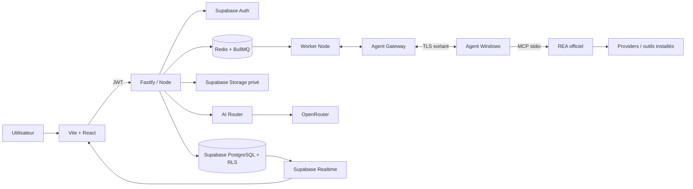

# Feuille de route de conception et de livraison

> **Périmètre actuel : conception uniquement.** Cette feuille décrit les travaux à réaliser ; elle ne lance ni n'automatise le développement. Suivre les phases dans l'ordre et ne franchir une porte que sur preuve vérifiable.

## Stack recommandée

| Couche | Choix | Responsabilité / règle |
|---|---|---|
| Web | Vite + React + TypeScript | SPA Analysis Studio ; Vite sert au développement/build, jamais à l'orchestration. |
| API | Node.js LTS + TypeScript + Fastify | REST, validation, autorisation, orchestration et accès privilégié. |
| Données / identité | Supabase PostgreSQL + Auth | Données relationnelles, identité, sessions ; schéma via migrations versionnées et RLS testée. |
| Fichiers | Supabase Storage | Buckets privés/quarantaine ; autorisation API et URL signées à courte durée. |
| Temps réel | Supabase Realtime au pilote | Notifications UI ; PostgreSQL/API restent l'état durable de référence. |
| Jobs | Redis + BullMQ + workers Node séparés | Analyses REA longues, concurrence, retry borné, annulation et reprise contrôlée. Redis n'est pas la source de vérité métier. |
| Agent local | Node.js + TypeScript | Connexion sortante authentifiée ; REA via MCP stdio en premier ; aucun port de commande entrant. |
| IA | Adaptateur serveur vers OpenRouter | Secrets côté serveur, minimisation, budget, traçabilité et fallback limité. |
| Hébergement | Docker sur serveur Node ; Supabase cloud au pilote | Cloudflare en périphérie/DNS si utile ; pas d'exécution REA dans Workers/Edge Functions. |
| Qualité | Vitest, intégration API, Playwright, GitHub Actions | Contrats REA, règles RLS, workflow agent et parcours utilisateur. |
| Observabilité | Logs structurés + OpenTelemetry | Corrélation par job/session, secrets masqués, métriques et alertes. |

**Règles Supabase :** la clé `service_role` ne va jamais dans Vite ni l'agent. Le navigateur n'utilise que la clé publique anon et un JWT utilisateur ; les tables exposées ont des politiques RLS minimales. Accès privilégiés, Storage et tâches passent par le backend. L'agent ne se connecte jamais directement à PostgreSQL. Pas de modification manuelle non versionnée en production.

**Pourquoi Redis/BullMQ ?** Une analyse REA peut durer et gérer des processus natifs : elle ne doit pas dépendre de la durée d'une requête HTTP/serverless. BullMQ pilote les workers ; PostgreSQL conserve l'état durable ; Realtime notifie l'UI. L'API et les workers restent d'abord un monolithe modulaire déployé en processus séparés.

## Vue d'exécution

## Cycle de vie du produit

1. **Cadrer :** objectif, utilisateurs, données, résultats attendus et hors périmètre.
2. **Autoriser :** propriété/permission, cibles incluses/exclues, opérations permises et fenêtre d'analyse. Sans autorisation démontrable, pas d'analyse.
3. **Concevoir :** stack, données, contrats, rôles, menaces, rétention et décisions ADR.
4. **Préparer :** dépôt, conventions, CI et environnements dev/staging ; secrets hors Git.
5. **Construire le socle :** Supabase/Auth/RLS, puis API Node et contrats.
6. **Intégrer REA :** audit Windows, agent, découverte réelle MCP/providers/capabilities et préservation des Evidence.
7. **Orchestrer :** queue/workers, attribution, états durables, événements et reprise contrôlée.
8. **Restituer :** Evidence, rapports traçables et UI Vite.
9. **Ajouter l'IA facultative :** après politique de données, budget, redaction et mode sans fournisseur.
10. **Valider/exploiter :** sécurité, staging, pilote autorisé, surveillance, sauvegarde, mises à jour et amélioration continue.

## Phases à suivre dans l'ordre

### Phase 0 — Base documentaire
- [ ] Relire et fusionner la PR documentaire après vérification : Markdown de conception seulement.
- [ ] Confirmer dépôt privé, responsable des décisions et convention ADR.
**Sortie :** README, architecture et roadmap présents sur le `main` principal. Aucun code applicatif commencé.

### Phase 1 — Audit de faisabilité REA sur Windows (premier travail technique)
- [ ] Choisir une release/tag officiel ; enregistrer URL, version, date et empreinte.
- [ ] Suivre les instructions officielles ; ne pas exécuter de script non vérifié.
- [ ] Consigner prérequis Node/OS, CLI/MCP/transport, outils et schémas exposés, providers/capabilities, erreurs, Evidence, sessions et artefacts.
- [ ] Tester sur cible de démonstration possédée/autorisée : résultat, limites, annulation, timeout et reprise après crash.
- [ ] Identifier outils tiers/licences, données qui peuvent quitter le PC et espace de travail.
- [ ] Établir matrice Windows/provider/capacité et tests de contrat avant upgrade.
**Sortie :** échange REA local reproductible, inventaire réel des capacités, prérequis/limites/licences documentés. Pas d'IA avant cette porte.

### Phase 2 — Spécifications et modèle de menace
- [ ] Trancher compte personnel ou multi-utilisateur, rôles, région, rétention/suppression.
- [ ] Définir états job/étape/agent, transitions, idempotence, annulation, reprise et approbations.
- [ ] Définir API et événements avec identifiant de corrélation.
- [ ] Menaces : SSRF, archives, secrets, isolation agent, fuites LLM, accès inter-workspaces.
- [ ] Documenter les décisions dans `docs/07-decisions/` avec alternatives et conséquences.
**Sortie :** contrats et permissions revus ; chaque donnée a classification, lieu, accès et rétention.

### Phase 3 — Environnements et CI
- [ ] Monorepo proposé : `apps/web`, `apps/api`, `apps/worker`, `apps/agent`, `packages/contracts`, `infra/`.
- [ ] Choisir pnpm, verrouiller Node LTS/pnpm, conventions format/lint/typecheck/tests/branches/PR.
- [ ] Séparer dev/staging ; secrets dans gestionnaire dédié, jamais dans Vite/Git.
- [ ] CI : format, lint, typecheck, tests, build et migrations ; protéger `main` par PR.
- [ ] Décrire Docker Compose de dev et reset des données de test.
**Sortie :** pipeline vert, secrets absents, staging reproductible.

### Phase 4 — Fondation Supabase
- [ ] Créer projets Supabase dev puis staging distincts ; configurer Auth/redirects.
- [ ] Schéma minimal : profils, workspaces, membres, projets, cibles, contraintes et timestamps.
- [ ] Versionner migrations SQL et vérifier installation sur base neuve en CI.
- [ ] RLS sur toutes les données accessibles au client ; test négatif utilisateur A contre B.
- [ ] Buckets privés/quarantaine, limites taille/type, politiques et URL signées courtes.
- [ ] Définir sauvegarde, rétention et restauration testée avant données réelles.
**Sortie :** accès inter-workspace refusé ; aucune clé privilégiée côté client.

### Phase 5 — API Node et contrats
- [ ] Fastify : validation de schémas, JWT Supabase, autorisation workspace/roles, limite débit/taille.
- [ ] API d'abord pour projets, cibles, agents et état d'analyse (sans lancer REA).
- [ ] Contrats OpenAPI versionnés, erreurs stables et pagination curseur.
- [ ] Audit structuré ; tests intégration API + Supabase/RLS.
**Sortie :** parcours API complet et permissions testées en succès et en refus.

### Phase 6 — Agent et adaptateur REA
- [ ] Enrôlement limité dans le temps, identité unique, révocation, rotation et heartbeat.
- [ ] Agent Windows : TLS sortant seulement, vérification identité/expiration/autorisation/capacités, répertoire borné.
- [ ] Client MCP stdio officiel ; découvrir tools, schémas, providers et capacités à l'exécution.
- [ ] N'attribuer que les tâches compatibles ; préserver provider/version/résultat brut/erreurs/Evidence.
- [ ] Tester agent révoqué, tâche expirée, provider absent, REA absent, timeout, arrêt brutal et annulation.
**Sortie :** analyse autorisée reproductible et preuves conservées ; aucun shell arbitraire distant.

### Phase 7 — Jobs et suivi
- [ ] PostgreSQL est l'état canonique ; messages BullMQ contiennent les références minimales.
- [ ] Workers séparés, concurrence limitée, timeout et retry par type d'opération.
- [ ] Machine d'état, idempotency key, événements persistants et annulation coopérative.
- [ ] Realtime/SSE pour notifications ; l'UI recharge via API après reconnexion.
- [ ] Simuler redémarrage API/worker/Redis et reconnexion agent ; éviter le double lancement non sûr.
**Sortie :** scénarios de panne couverts ; aucune tâche annulée/incomplète affichée réussie.

### Phase 8 — Evidence et rapports
- [ ] Métadonnées en Postgres, contenu lourd en Storage privé ; empreinte, provenance, versions, session, couverture et limites.
- [ ] Pagination/accès objet autorisé ; redaction avant export.
- [ ] Rapport distingue observation, dérivation, hypothèse, inconnu et conclusion ; chaque fait pointe vers Evidence.
**Sortie :** rapport vérifiable contre résultat REA original après reconnexion.

### Phase 9 — IA facultative
- [ ] Classifier sensibilité ; transfert désactivé par défaut pour données sensibles.
- [ ] OpenRouter côté serveur ; enregistrer modèle, Evidence transmises, coût/usage et erreur.
- [ ] Budgets, timeout, retries bornés et modèles de secours autorisés.
- [ ] Tester quota, indisponibilité, réponse invalide, contexte trop grand et mode sans IA.
**Sortie :** aucun transfert non autorisé ; REA fonctionne sans LLM.

### Phase 10 — UI Vite
- [ ] Dashboard, projet/cible, agents, création/suivi de job via API.
- [ ] Analysis Studio : cible/étapes, résultats, Evidence/limites, journal et erreurs.
- [ ] Centre de ressources en quarantaine ; rapports exportables sourcés.
- [ ] E2E Playwright : projet → cible autorisée → agent en ligne → analyse → rapport ; tester aussi erreurs/annulation.
**Sortie :** parcours compréhensible ; états partiels et erreurs visibles.

### Phase 11 — Sécurité et pilote
- [ ] Revue RLS, secrets, agent, SSRF, archives, Storage, logs et permissions.
- [ ] Charge/quotas, limites CPU/mémoire/espace, sauvegarde-restauration et révocation agent.
- [ ] Déployer staging, exécuter recette, documenter rollback/incident.
- [ ] Pilote seulement avec périmètre écrit, cible contrôlée et approbation humaine.
- [ ] Production après validation coûts, rétention, alertes et plan de réponse.
**Sortie :** critères d'acceptation atteints ; version REA et déploiement reproductibles.

## Dépendances et ordre

`Audit REA` → `Contrats + threat model` → `CI/environnements` → `Supabase/RLS` → `API` → `Agent/REA` → `Queue/suivi` → `Evidence/rapports` → `IA` → `UI complète` → `Pilote`.

Un prototype UI statique est possible plus tôt, mais ne retarde pas la preuve d'intégration REA. IA, import activable et pilote restent bloqués tant que sécurité, provenance et permissions ne sont pas prouvées.

## À faire immédiatement

1. [ ] Relire puis fusionner la PR documentaire sur le dépôt principal ; vérifier qu'elle ne contient que Markdown.
2. [ ] Valider provisoirement : Vite/React, Fastify/Node, Supabase Auth/Postgres/Storage/Realtime, Redis/BullMQ, agent Windows, OpenRouter facultatif.
3. [ ] Ouvrir les ADR sur Supabase/RLS, queue, transport agent↔backend, version REA, région et politique IA.
4. [ ] Commencer **Phase 1 seulement** : choisir release REA officielle et auditer sur Windows avec cible possédée/autorisée.
5. [ ] Publier résultats vérifiés (versions, commandes réellement testées, capacités, limites et licences) avant d'initialiser l'application.

## Suivi « automatique »

À ce stade, le suivi est une checklist manuelle à portes de sortie : cocher uniquement avec preuve (PR, test ou décision), ne jamais sauter une phase bloquée. Plus tard, recopier les tâches en issues GitHub liées à des jalons/PR et faire appliquer les contrôles par CI. Ce document ne lance pas automatiquement commandes, analyses ni dépenses cloud/IA.
